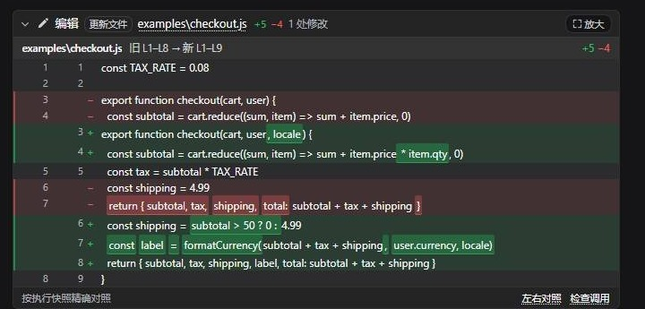
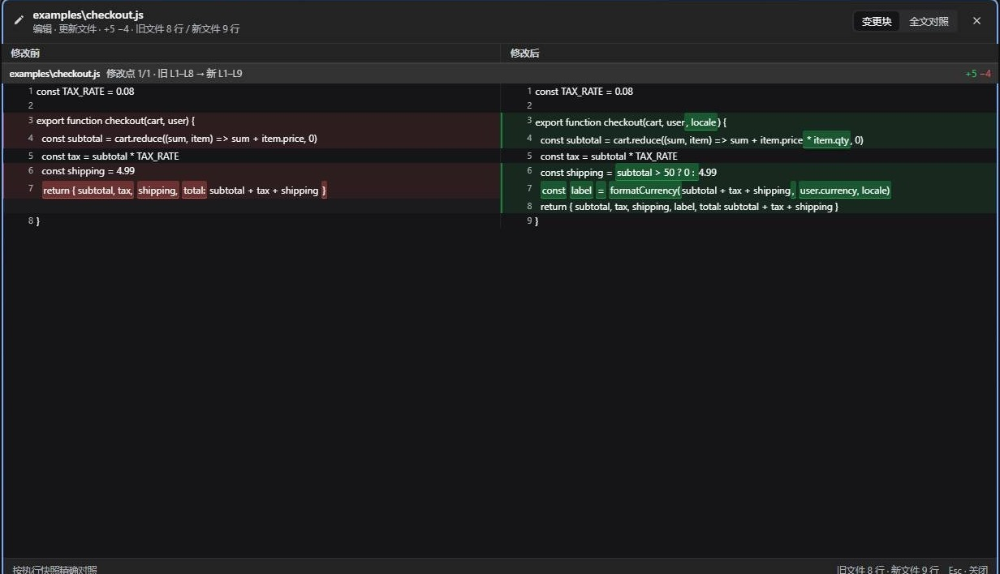
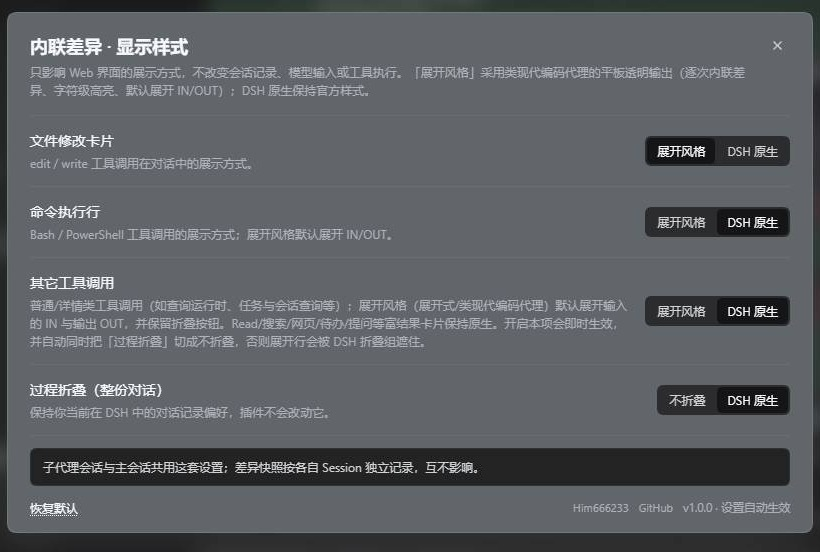

# DSH Inline Diff · 内联差异

在 [DeepSeek Harness](https://github.com/deepseek-ai) 的对话流里，为每一次文件修改就地渲染可展开的差异卡片，并提供左右对照、行内字符级高亮、移动块/被动行号说明和读取行范围展示。

**作者**：[Him666233](https://github.com/Him666233) · **仓库**：[Him666233/dsh-inline-diff](https://github.com/Him666233/dsh-inline-diff) · **License**：[MIT](LICENSE)

> 中文为主；插件内部名称、设置项和 UI 全部使用中性描述，不包含第三方产品品牌字样。
> 本仓库的「展开风格」指展开式、平板式、类现代编码代理的透明输出效果。

## 截图

### 内联差异卡片

编辑/写入工具调用在原位置显示修改对比：绿色新增、红色删除、精确旧/新行号，行内变化只高亮真正改动的片段。



### 左右对照放大

点击「放大」打开全屏对照，按修改点分组；顶部「全文对照」可查看整份修改前/后文件。



### 读取行范围

Read 工具行保留 DSH 原生卡片和展开行为；折叠时在文件名右侧显示本次读取的实际行范围，单行与多范围均支持。


### 设置面板

四项展示风格可分别配置；底部标注作者、仓库和版本号。



## 功能

- **逐次内联差异**：`edit` / `write` / `str_replace_editor` 每次调用单独一张卡片，不等待整轮结束。
- **精确行号与修改点**：旧文件行号、新文件行号双栏显示；多修改点各有独立表头，写明 `旧 Lx–Ly → 新 Lm–Ln` 与 `+/−` 统计。
- **行内字符级高亮**：替换行只把真正变化的 token 标深红/深绿，避免整行染色。
- **移动识别**：完全相同的连续代码块纯粹移动时，删除侧标「移至 新 Lx–Ly」、新增侧标「移自 旧 Lx–Ly」；边界空行不影响识别。
- **被动行号位移**：未改区段显示旧→新行号范围与「行号顺延 ±N」，用于说明插入/删除/移动造成的被动换行。
- **左右对照**：变更块模式按修改点分组；全文对照模式对整份修改前/后文件逐行对齐。
- **固定表头**：内联卡片和放大弹窗里的文件/修改点横条滚动时吸顶。
- **读取范围外显**：Read 行折叠时显示 `L x – L y`（单行 `L x`，多范围用 ` · ` 分隔）；展开时自动隐藏，不覆盖 DSH 原生展示。
- **两种展示风格**：文件卡片、命令执行行、其它工具调用、过程折叠均可单独选择「展开风格 / DSH 原生」。
- **工具行差异化**：命令行使用终端图标、等宽标题和绿色强调；通用工具调用带「工具调用」标签、插件图标和品牌色强调；两者都保留轨迹跳转按钮。
- **大文件 / 历史回放降级**：超出预算时退回工具元数据差异块并明确提示；历史回放无法全文对照时，放大弹窗内说明原因。
- **主题安全**：所有颜色、字体和圆角取自宿主主题 token（`--dsw-alias-*`），不写死颜色；跟随 DSH 原生主题、第三方主题和明暗模式。

## 兼容性

| 环境 | 支持情况 |
| --- | --- |
| DSH 桌面端（Desktop profile） | ✅ 已验证 |
| DSH Web UI（Web profile） | ✅ 代码兼容；需在该 profile 单独安装本插件 |
| 浏览器 / Electron 内嵌 WebView | ✅ 客户端使用标准 Web platform |
| 第三方主题 / 桌宠 / 皮肤 | ✅ 颜色跟随主题 token；主题与桌宠属于外部插件，不影响本插件安装 |

**DSH 版本范围（`engines.dsh`）**：`>=0.2.2-rc.1 <0.3.0`。当前版本在 DeepSeek Harness `0.2.2-rc.1`（desktop profile）实测通过。

插件在 `plugin/package.json` 声明了 `engines.dsh`；DSH 插件加载器会校验该范围，**不在范围内时拒绝自动加载**，避免把未验证的宿主版本当成可用环境。插件清单同时声明 `dsh.client.platform: web`，Host 端只使用通用的 `webServer`、`tools/result` 与 Node.js 文件读取能力，不依赖 Electron 或桌面专属 API。

> 注意：DSH 插件按 **profile** 独立安装。桌面端与 Web UI 端若使用不同 profile，需要分别在对应 profile 中安装一次；本插件不会自动跨 profile 同步。DSH 升级到 `0.3.0` 或更高版本前，请等待本插件发布新的兼容版本。

## 安装

### 方式一：DSH 插件管理器（推荐）

1. 下载本仓库或 Release 中的插件包；
2. 打开 DSH 设置 → 插件管理；
3. 选择“从本地目录安装”，指向本仓库的 `plugin/` 目录；
4. 刷新或重启 DSH。

插件包目录 `plugin/` 自带 `package.json`、`client.js`、`index.js`、`cordis.patch.yml`、locale 和 icon，可直接被 DSH 作为本地 bundle 加载。

### 方式二：手动 link 安装

把 `<repo>/plugin` 链接到目标 profile：

```bash
cd ~/.dsh/profiles/<profile>
pnpm add link:/absolute/path/to/dsh-inline-diff/plugin
```

然后在同一 profile 的 `package.json` 中加入：

```json
{
  "dependencies": {
    "@local/dsh-inline-diff": "link:/absolute/path/to/dsh-inline-diff/plugin"
  },
  "dsh": {
    "profile": {
      "bundles": ["@local/dsh-inline-diff"]
    }
  }
}
```

重启 DSH 后生效。桌面端和 Web UI 若使用不同 profile，请分别在各自 profile 中执行。

### 从源码构建

```bash
npm install
npm run build      # -> plugin/client.js
npm run check      # 语法 / JSON 校验
npm test           # 差异引擎与 read range 单元测试
```

需要 Node.js 20+（构建依赖 `esbuild`）。插件运行时无额外依赖，只使用 React 与宿主提供的 Web 服务。

## 使用

### 内联卡片

在对话中定位到 `编辑` / `更新文件` 卡片：

- 点击卡片头部：展开或折叠逐行差异；
- 点击「放大」：打开左右对照弹窗；
- 点击「左右对照」链接：同样打开弹窗；
- 点击「检查调用」或行右侧轨迹按钮：跳转到对应轨迹位置。

### 设置项

| 设置项 | 选项 | 说明 |
| --- | --- | --- |
| 文件修改卡片 | 展开风格 / DSH 原生 | 展开风格 = 本插件的逐次内联差异卡片；DSH 原生 = 官方 file-mutation 行 |
| 命令执行行 | 展开风格 / DSH 原生 | 展开风格 = 默认展开 IN/OUT 的扁平命令行；DSH 原生 = 官方 bash/pwsh 行 |
| 其它工具调用 | 展开风格 / DSH 原生 | 展开风格 = 普通/详情类工具默认展开 IN/OUT；富结果卡片（Read/搜索/网页/待办/提问）保持原生 |
| 过程折叠（整份对话） | 不折叠 / DSH 原生 | 不折叠 = 写入 DSH `ui-chat.transcriptView = verbose` 偏好；DSH 原生 = 保留用户已有偏好 |

设置入口：

- 侧边栏底部：**差异样式**；
- DSH 设置页：**内联差异 · 显示样式**。

设置保存在浏览器 `localStorage`（键 `dsh-inline-diff.settings.v3`）；旧 `v2` 值会在首次加载时迁移为新值并删除旧键。过程折叠选项通过 DSH 官方 `configForms` 服务写入，可随时恢复。

### 读取行范围

Read 工具行折叠时，范围标签位于文件名右侧。展开该行后标签自动隐藏，完全显示 DSH 原生 Read 卡片内容。

## 项目结构

```
dsh-inline-diff/
├─ src/client/                 # 浏览器端源码
│  ├─ index.jsx                # 插件入口 / slot 注册
│  ├─ project.js               # 作者、仓库、版本
│  ├─ components.jsx           # 差异卡片与放大弹窗
│  ├─ diff.js                  # 行对齐 / hunk / 移动 / 行内 token diff
│  ├─ model.js                 # 工具调用 → 卡片模型
│  ├─ enhanced-tools.jsx       # 展开风格工具调用行
│  ├─ enhanced-shell.jsx       # 展开风格命令执行行
│  ├─ read-range.js            # Read 行范围提取
│  ├─ read-range-dom.js        # 页面级 Read 范围挂载
│  ├─ settings.js              # 设置存储与迁移
│  ├─ settings-ui.jsx          # 设置页/弹窗
│  ├─ styles.js                # 全部主题 token 样式
│  ├─ locales.js               # 中英文字典
│  └─ api.js / store.js        # 与 Host 通信、弹窗状态
├─ plugin/                     # 可安装插件包（Host + 构建后的 client.js）
├─ tests/                      # 纯 Node 单元测试
├─ docs/                       # 干净截图
├─ build.mjs                   # esbuild 打包
├─ package.json
├─ CHANGELOG.md
├─ LICENSE
└─ README.md
```

## 内部实现

### Host 端

- 监听 `tools/result`，对成功的 `edit` / `write` 截取 `{ path, before, after, operation }`，保存到内存 LRU；
- 提供同源只读 API：
  - `POST /dsh-inline-diff/api/snapshot`：按 `sessionId + callId` 返回快照；
  - `POST /dsh-inline-diff/api/read`：在会话 workspace 内读取文件（realpath 两层 containment）；
  - `GET /dsh-inline-diff/api/ping`：健康检查。
- 快照只存在内存，不落盘；应用重启后历史卡片退化为“修改块 + 当前文件定位行号”的展示，因此「全文对照」不可用。

### Client 端

- 通过 `ctx.slots` 接管 `tool.call.toolview` 的 edit/write/命令/普通工具行，并常驻注册 `conversation.chat.node` 的 tool-call 渲染器；
- 纯浏览器侧实现 LCS 对齐、hunk 分组、行内 token diff、移动块配对、被动位移 gap、超大文件预算回退；
- Read 范围使用页面级 `MutationObserver` 挂载到官方 Read 行文件名后，不依赖某一条内部渲染路径；
- 全屏弹窗通过 React Portal 挂到 `document.body`，避免被第三方浮动层遮挡。

### 数据与隐私

- 无网络请求、无遥测、无外部服务；不读取 DSH 会话外文件；
- 只有显示所需的修改前后文本在 Host 内存中短暂保留；默认不写磁盘；
- 设置只写入浏览器 localStorage；不包含文件内容；
- 颜色全部由宿主主题 token 派生，插件不附带壁纸或人物素材。

## 已知限制

- **全文对照依赖快照**：应用重启后的历史回放无法还原修改前全文，页签置灰并在放大弹窗显示原因。
- **超大文件**：任一侧 > 4000 行或 LCS 矩阵超预算时降级为差异块模式，关闭移动识别和全文对照。
- **移动识别**：只识别完全相同的连续行块；移动同时伴随内容修改的块按普通增删显示。
- **接管的工具**：仅支持 DSH 原生 `edit` / `write` / `str_replace_editor`；手工写入或外部工具改动不会生成卡片。
- **跨 profile**：插件按 profile 安装，不自动同步。

## 开发与贡献

```bash
npm install
npm run build
npm run check
npm test
```

- 修改 `src/client/` 后需要重新执行 `npm run build`，安装的是 `plugin/` 中构建后的 `client.js`；
- 提交前请确保 `npm run check` 与 `npm test` 通过；
- 项目身份集中维护在 [`src/client/project.js`](src/client/project.js)；仓库改名时同步更新该文件、`package.json` 的 `homepage` / `repository` / `bugs` 及 README 链接即可。

## 更新日志

版本日期索引：

| 版本 | 发布日期 | 摘要 |
| --- | --- | --- |
| 1.0.0 | 2026-11-05 | 首个公开开源版本 |
| 0.2.2 | 2026-11-03 | 行内高亮、移动范围、测试 |
| 0.2.1 | 2026-11-03 | 安装与样式修复 |
| 0.2.0 | 2026-11-03 | 展开风格与工具行配置 |
| 0.1.0 | 2026-11-02 | 内部原型 |

详细变更见 [CHANGELOG.md](CHANGELOG.md)。

## License

[MIT](LICENSE) © 2026 [Him666233](https://github.com/Him666233)
